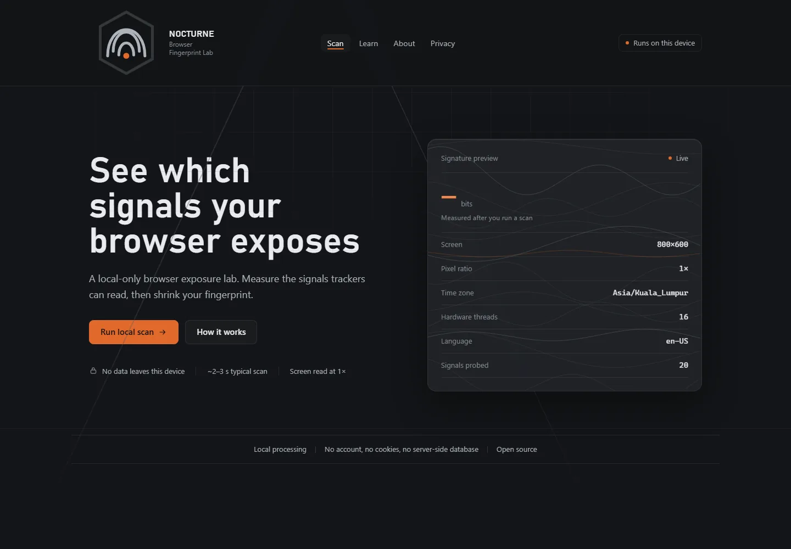

# NOCTURNE

**Browser Fingerprint Lab** — a local-only browser exposure test.

NOCTURNE measures the signals a website can request from your browser, estimates how many identifying bits they represent, and shows which surfaces are stable, randomised, or blocked. It runs entirely in the browser: no backend, no database, no analytics, no account, and no report upload.

> **Independent project.** NOCTURNE is inspired by [EFF's Cover Your Tracks](https://coveryourtracks.eff.org/), but it is not affiliated with, endorsed by, or sponsored by the Electronic Frontier Foundation. It uses an original name, visual identity, code, and copy.

## Why this is different

- **Static by default.** The entire app is HTML, CSS, and vanilla ES modules. There is no build step and no npm dependency.
- **No data collection.** Reports exist only in the current tab's memory. The only optional persistence is a report you explicitly download.
- **Honest about uniqueness.** A true “1 in N browsers” result needs a live population database. NOCTURNE uses a documented reference model and labels the result as an estimate.
- **No tracker simulator.** EFF's original test uses its own third-party tracker domains. NOCTURNE cannot reproduce that without infrastructure, so it uses local privacy signals and a low-confidence ad-filter heuristic instead.
- **Fast.** The landing route is around 24 KB gzipped; the scan engine is lazy-loaded. No web fonts or raster images are loaded by the app, and it makes no third-party runtime requests. The README screenshot is a small WebP.

## Privacy model

- No analytics, advertising, remote fonts, CDNs, or third-party images.
- The CSP blocks outbound connections: `connect-src 'none'`.
- Temporary cookie/localStorage probes are deleted immediately and contain no identifier.
- Reports are held in memory only; refreshing clears the report.
- WebRTC uses an empty STUN list, so it makes no external request.
- No camera, microphone, location, or notification permission is requested.
- GitHub Pages can still see the request that served the files, as with any host. That is disclosed in the app.

## Method

The short version:

1. Collect local signals: browser, display, locale, canvas, WebGL, audio, fonts, media, storage, privacy flags, WebRTC candidates, and a blocker heuristic.
2. Double-sample canvas, WebGL, and audio. A changed hash means the surface is randomised and is excluded from the stable signature.
3. Sum per-attribute low/high ranges, apply a 0.5 correlation discount, cap at 24 bits, and present a range plus a coverage-based confidence.
4. Canonicalise stable values and hash them with SHA-256 via the browser's Web Crypto.

See [`docs/METHODOLOGY.md`](docs/METHODOLOGY.md) for the full table and limitations.

## License

MIT. See [`LICENSE`](LICENSE). EFF is credited in [`NOTICE.md`](NOTICE.md); no EFF code, logo, or site copy is included.
