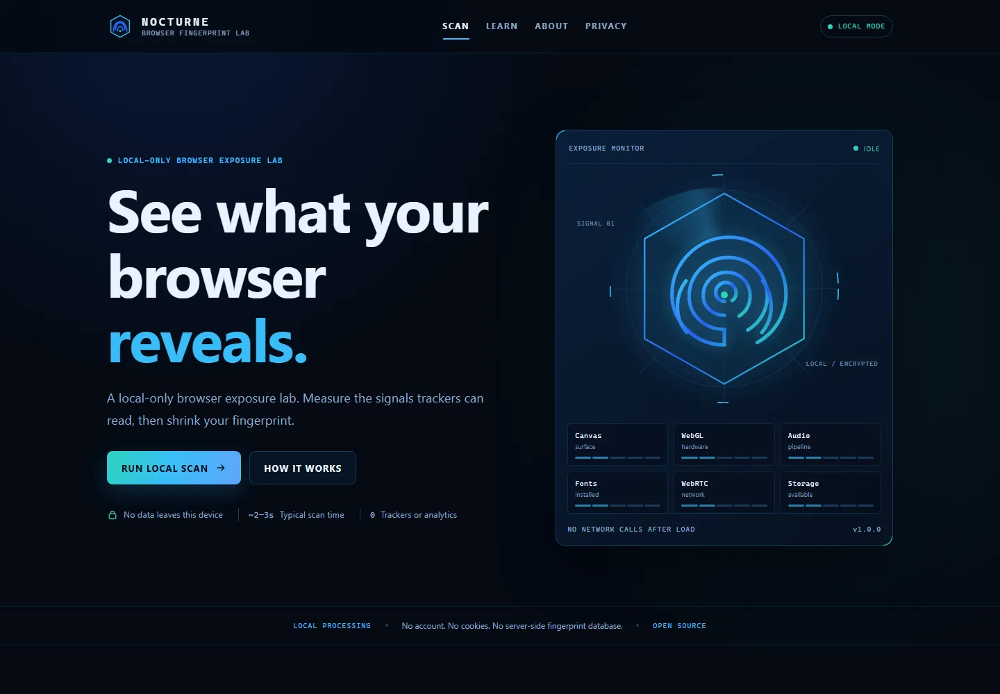

# NOCTURNE

**Browser Fingerprint Lab** — a local-only browser exposure test.



NOCTURNE measures the signals a website can request from your browser, estimates how many identifying bits they represent, and shows which surfaces are stable, randomised, or blocked. It runs entirely in the browser: no backend, no database, no analytics, no account, and no report upload.

> **Independent project.** NOCTURNE is inspired by [EFF's Cover Your Tracks](https://coveryourtracks.eff.org/), but it is not affiliated with, endorsed by, or sponsored by the Electronic Frontier Foundation. It uses an original name, visual identity, code, and copy.

## Why this is different

- **Static by default.** The entire app is HTML, CSS, and vanilla ES modules. There is no build step and no npm dependency.
- **No data collection.** Reports exist only in the current tab's memory. The only optional persistence is a report you explicitly download.
- **Honest about uniqueness.** A true “1 in N browsers” result needs a live population database. NOCTURNE uses a documented reference model and labels the result as an estimate.
- **No tracker simulator.** EFF's original test uses its own third-party tracker domains. NOCTURNE cannot reproduce that without infrastructure, so it uses local privacy signals and a low-confidence ad-filter heuristic instead.
- **Fast.** The landing route is around 18 KB gzipped; the scan engine is lazy-loaded. No web fonts or raster images are loaded by the app, and it makes no third-party runtime requests. The README screenshot is a 48 KB WebP.

## Run locally

Requirements: Node.js 20 or newer. No install step is required.

```bash
node scripts/serve.mjs
# open http://127.0.0.1:4173/
```

Or use any static file server from the repository root. Do not open `index.html` with `file://`; ES modules and Web Crypto need an HTTP(S) origin.

## Test

```bash
npm test
npm run check:budget
```

No dependencies are installed. The tests use Node's built-in test runner. `npm test` runs the suites in one process for compatibility with restricted environments.

Optional browser QA requires a local Chrome started with a debugging port; see [`scripts/cdp-audit.mjs`](scripts/cdp-audit.mjs). It is a development helper, not part of the shipped app.

## Deploy for free on GitHub Pages

1. Create a public GitHub repository, for example `nocturne`.
2. Push this repository to `main`.
3. In the repository, open **Settings → Pages**.
4. Under **Build and deployment**, choose **Deploy from a branch**.
5. Select `main` and `/ (root)`, then save.
6. Open `https://<your-username>.github.io/nocturne/`.

No GitHub Actions, build command, custom domain, CNAME, database, or paid service is required. The included `.nojekyll` keeps GitHub Pages from treating the files as a Jekyll site.

Before publishing, optionally set `repoUrl` in [`src/data/brand.js`](src/data/brand.js) so the header and footer show a working GitHub link.

## Configuration

- **Brand name, links, version:** `src/data/brand.js`
- **Entropy ranges and model version:** `src/data/reference-model.js`
- **Font detection list:** `src/data/fonts.js`
- **Signal advice:** `src/data/recommendations.js`
- **Design tokens and layout:** `assets/styles.css`

## Privacy model

- No analytics, advertising, remote fonts, CDNs, or third-party images.
- The CSP blocks outbound connections: `connect-src 'none'`.
- Temporary cookie/localStorage probes are deleted immediately and contain no identifier.
- Reports are held in memory only; refreshing clears the report.
- WebRTC uses an empty STUN list, so it makes no external request.
- No camera, microphone, location, or notification permission is requested.
- GitHub Pages can still see the request that served the files, as with any host. That is disclosed in the app.

## Images

The app loads **no raster images**. The logo, favicon, hero art, and decorations are inline SVG/CSS, which is smaller and sharper than a raster asset. Any raster asset added later — for example a README screenshot — must be **WebP** with explicit dimensions and lazy/async loading.

## Method

The short version:

1. Collect local signals: browser, display, locale, canvas, WebGL, audio, fonts, media, storage, privacy flags, WebRTC candidates, and a blocker heuristic.
2. Double-sample canvas, WebGL, and audio. A changed hash means the surface is randomised and is excluded from the stable signature.
3. Sum per-attribute low/high ranges, apply a 0.5 correlation discount, cap at 24 bits, and present a range plus a coverage-based confidence.
4. Canonicalise stable values and hash them with SHA-256 via the browser's Web Crypto.

See [`docs/METHODOLOGY.md`](docs/METHODOLOGY.md) for the full table and limitations, and [`docs/PERFORMANCE.md`](docs/PERFORMANCE.md) for the performance budgets.

## Browser support

Modern evergreen Chrome, Edge, Firefox, and Safari. Probes degrade gracefully when an API is unavailable or blocked. The site needs an HTTPS origin (or localhost) for `crypto.subtle`; GitHub Pages provides HTTPS automatically.

## Repository layout

```text
index.html               app shell and static header/footer
assets/styles.css        design system and all layout
src/main.js              router boot and lazy view loading
src/views/               home, test, results, learn, about, privacy
src/collectors/          independent browser probes
src/lib/                 hashing, canonicalisation, entropy, formatting
src/data/                brand, model, fonts, recommendations
tests/                   Node test suites
scripts/                 local server and budget check
docs/                    methodology, deployment, performance
```

## License

MIT. See [`LICENSE`](LICENSE). Credits for EFF [`NOTICE.md`](NOTICE.md).
